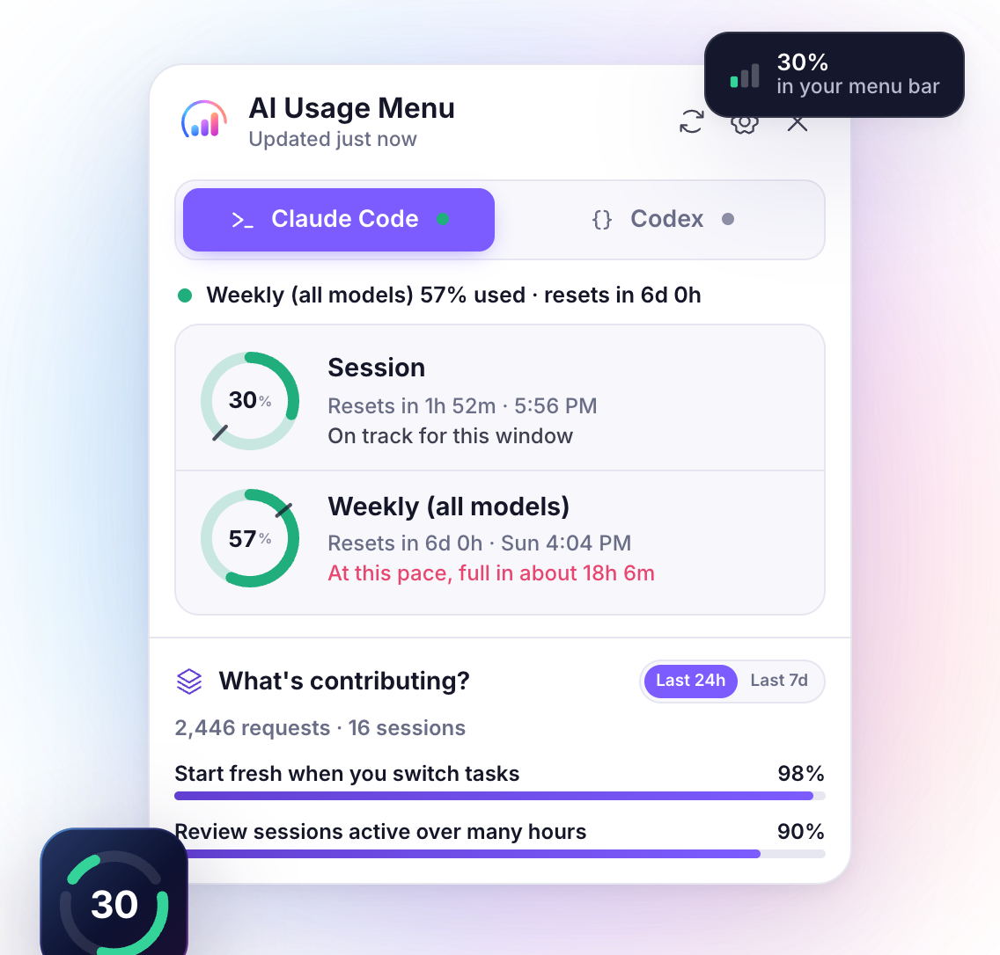
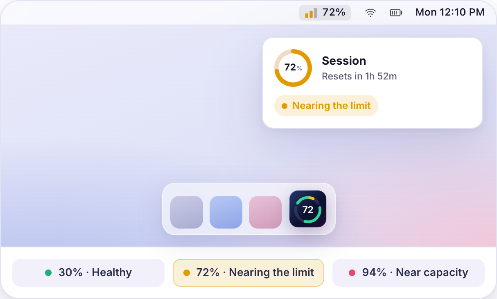
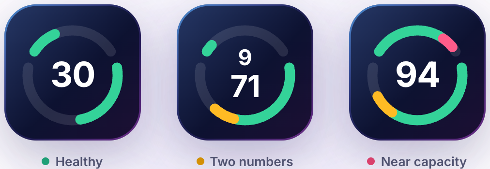
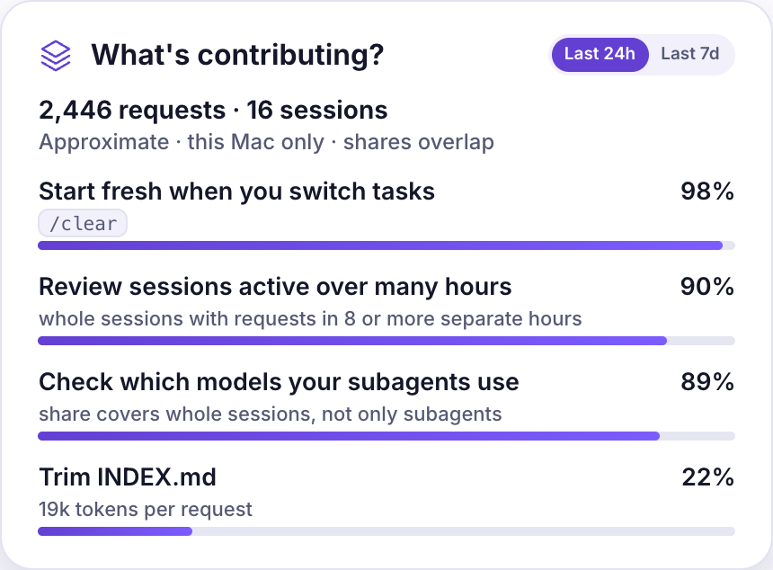
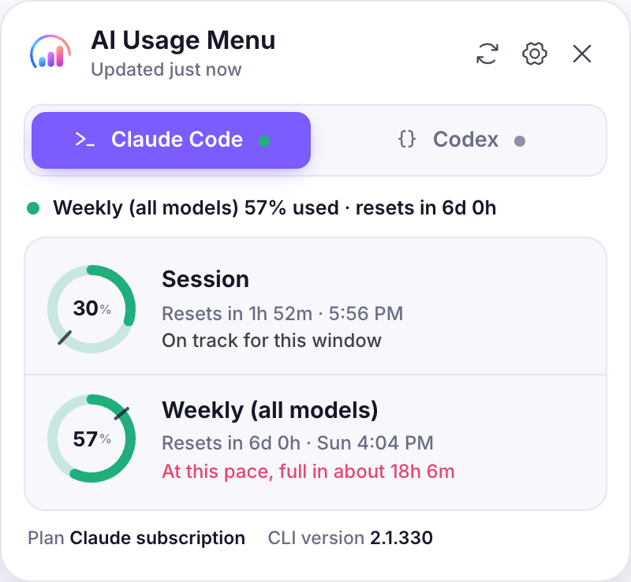
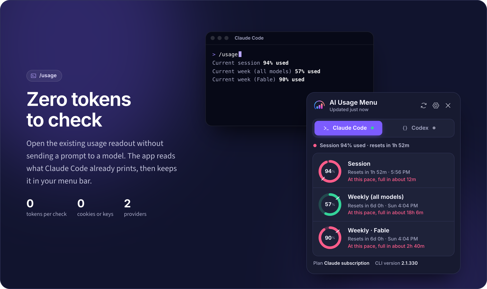
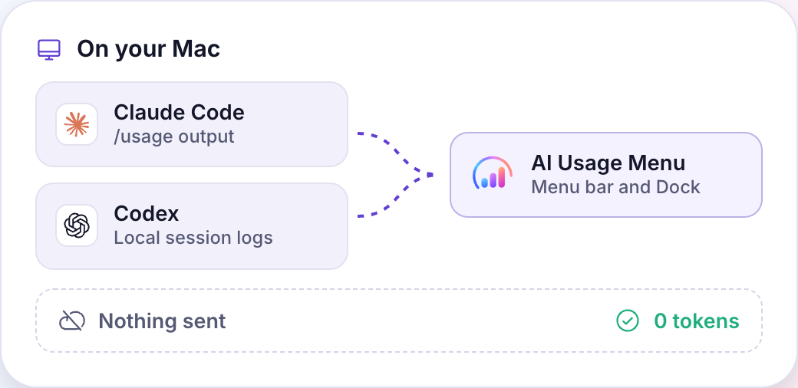

<div align="center">


# AI Usage Menu

**A free, open-source Claude usage tracker for Mac.** See your Claude Code and Codex limits in the menu bar and Dock, with no cookie or API key.

[](https://github.com/navbuildz/ai-usage-menu/releases/latest/download/AIUsageMenu.dmg)
&nbsp;
[](https://aiusagemenu.com)

[](https://github.com/navbuildz/ai-usage-menu/releases/latest)
[](#requirements)
[](#requirements)
[](#build-from-source)
[](LICENSE)
[](#key-facts)

<picture>
  <source media="(prefers-color-scheme: dark)" srcset="docs/readme/hero-dark.png">
  
</picture>

</div>

AI Usage Menu is a free, MIT-licensed Mac app that shows your **Claude Code usage** and **Codex usage** where you already look: the menu bar and the Dock. It shows the 5-hour session limit and the weekly limit, when each one resets, how fast you are using them, and what is filling them up. It reads what Claude Code and Codex already show on your Mac, so there is no cookie, password or API key to paste, and checking costs zero tokens.

> [!TIP]
> Works with **Claude Pro, Max and Team** plans and **ChatGPT plans for Codex**. API-key accounts pay per token and have no plan limits to show.

## Contents

- [Why AI Usage Menu](#why-ai-usage-menu)
- [Features](#features)
- [How it works](#how-it-works)
- [Privacy](#privacy)
- [Install](#install)
- [Requirements](#requirements)
- [Settings](#settings)
- [Key facts](#key-facts)
- [Claude usage trackers compared](#claude-usage-trackers-compared)
- [FAQ](#faq)
- [Guides](#guides)
- [Feedback](#feedback)
- [Contributing](#contributing)
- [Security](#security)
- [License](#license)

## Why AI Usage Menu

|  |  |
| --- | --- |
| 🔒 **No cookie, no key, nothing to paste** | It reads Claude Code's own `/usage` output and Codex's local session logs. Many trackers ask for a claude.ai cookie, a session key, an API key or a sign-in instead. |
| 💻 **Nothing leaves your Mac** | Usage is read and shown locally. AI Usage Menu itself only checks for updates once a day, and you can turn that off. |
| 📊 **What's contributing** | See what is eating your Claude limit: long-running sessions, subagent models and large context files, each with what to do about it. |
| 🍩 **A live Dock icon** | A ring that fills green, then amber, then red. The upper arc is your session and the lower arc is your week. |
| 🪙 **Zero tokens to check** | Reading usage opens the existing readout. It never sends a prompt to a model. |
| 🆓 **Free and open source** | MIT-licensed Swift. Read every line that touches your data. |

## Features

### Your Claude and Codex limits, at a glance in the menu bar

Each window has its own percentage and reset time. The menu bar gauge lights one mint bar while you are healthy, two amber bars as you near the limit and three red bars near capacity. Show one combined item, or one item per provider so Claude and Codex stay visible together.

<picture>
  <source media="(prefers-color-scheme: dark)" srcset="docs/readme/menu-bar-dark.png">
  
</picture>

### A Dock icon that fills as you go

Read two windows in one ring. The short upper arc follows the 5-hour session and the long lower arc follows the week. Choose one number, or two: the session on top and the week below.

<picture>
  <source media="(prefers-color-scheme: dark)" srcset="docs/readme/dock-dark.png">
  
</picture>

### See what's eating your Claude limit

Inspect local Claude Code activity over the last 24 hours or 7 days: sessions active over many hours, repeated context, subagent models and oversized context files, ranked by their share of your requests.

<picture>
  <source media="(prefers-color-scheme: dark)" srcset="docs/readme/activity-dark.png">
  
</picture>

### Claude Code and Codex, side by side

Switch provider tabs to see each one's limits, plan and reset times. Each reading shows a pace line ("At this pace, full in about 18h 6m" or "On track for this window"), and an old Codex reading turns gray so a stale number never passes for a current one.

<picture>
  <source media="(prefers-color-scheme: dark)" srcset="docs/readme/providers-dark.png">
  
</picture>

### Zero tokens to check

AI Usage Menu reads the same numbers Claude Code prints for `/usage` and keeps them in your menu bar. No prompt is sent and no tokens are used.



## How it works

| Provider | What AI Usage Menu reads | What it never reads |
| --- | --- | --- |
| **Claude Code** | The output of Claude Code's own `/usage` command, plus one field of `~/.claude.json`, `cachedUsageUtilization`: the usage figures Claude Code saves when `/usage` runs, so your numbers are current rather than one refresh behind. No other field in that file is decoded. | Cookies, passwords, API keys, browser profiles, Keychain items |
| **Codex** | The newest session log under `$CODEX_HOME/sessions` (default `~/.codex/sessions`), read from the end of the file, and only the `auth_mode` value of `~/.codex/auth.json`. | Keys, tokens or any other field of `auth.json` |

- Each Claude read runs in the same empty working directory, `~/Library/Application Support/AI Usage Menu/claude-workdir/`, so Claude Code's own project bookkeeping stays in one place.
- Snapshots stay in memory and usage text is never logged.
- Claude Code itself may contact Anthropic when it produces its usage readout. That request belongs to Claude Code, not to AI Usage Menu.
- A missing limit is shown as unavailable. The app never invents a percentage from a plan name.

Read the full walkthrough on [how AI Usage Menu reads your usage without a cookie](https://aiusagemenu.com/privacy).

## Privacy

<picture>
  <source media="(prefers-color-scheme: dark)" srcset="docs/readme/privacy-dark.png">
  
</picture>

- **The app has no analytics and no telemetry.** Processing happens on your Mac. (The website, aiusagemenu.com, uses Google Analytics and Cloudflare Web Analytics to count visits and downloads.)
- **No usage network calls.** AI Usage Menu itself only checks for updates once a day, and you can turn that off.
- **Verify it yourself.** A test in this repository fails if network APIs appear anywhere outside the updater, and you can sample the running app:

```sh
pid=$(pgrep -x "AI Usage Menu" | head -n 1)
lsof -nP -a -i -p "$pid"
```

## Install

### Download

1. [Download the signed, notarized DMG](https://github.com/navbuildz/ai-usage-menu/releases/latest/download/AIUsageMenu.dmg).
2. Open it and drag **AI Usage Menu** to Applications.
3. Open the app, review the providers it finds, and choose your menu bar and Dock views.

Verify the download:

```sh
codesign --verify --deep --strict "/Applications/AI Usage Menu.app"
spctl --assess --type execute "/Applications/AI Usage Menu.app"
```

### Build from source

Use Xcode with Swift 6. The deployment target is macOS 13. From the repository root:

```sh
git clone https://github.com/navbuildz/ai-usage-menu.git
cd ai-usage-menu
./app/build.sh
./app/build.sh test
open "app/build/Build/Products/Release/AI Usage Menu.app"
```

The project is generated from `app/project.yml`; after changing targets or build settings, run `cd app && xcodegen generate`. Source builds are unsigned; the signed, notarized app comes from the [releases page](https://github.com/navbuildz/ai-usage-menu/releases).

## Requirements

| | |
| --- | --- |
| **Mac** | macOS 13 Ventura or later, on Apple silicon or Intel (one universal app) |
| **Claude** | Claude Code installed and signed in with a Claude Pro, Max or Team plan |
| **Codex** | Codex used with a ChatGPT plan sign-in on the same Mac |
| **Not supported** | API-key accounts, which have no plan limits to show |

## Settings

- **Menu bar:** one combined item that follows the most constrained reading, or one item per provider. Show the gauge alone or add the percentage. Choose the 5-hour or weekly number.
- **Dock:** show it or hide it, one number or two, and its own System, Light or Dark appearance. Auto keeps both arcs on the provider closest to its limit.
- **Refresh:** every 5 minutes by default, or 2, 10, 15 or 30. Manual, wake and Codex file-change refreshes work on their own.
- **Alerts and launch at login** are optional, and so is the daily update check.

## Key facts

| | |
| --- | --- |
| **Product** | A Mac menu bar and Dock app for tracking Claude Code and Codex usage. |
| **Platforms** | macOS 13 or later on Intel and Apple silicon. |
| **Plans** | Claude Pro, Max and Team, and ChatGPT plans for Codex. API-key accounts have no plan limits to show. |
| **Data sources** | Claude Code’s /usage output and the usage figures it caches in ~/.claude.json; Codex’s local session logs. |
| **Network calls** | None for usage readings. AI Usage Menu itself only checks for updates once a day, and you can turn that off. Claude Code itself may contact Anthropic. |
| **Price** | Free. |
| **License** | MIT. |
| **Maker** | TypeFire. |

## Claude usage trackers compared

How Mac usage trackers for Claude and Codex get their data, from each project's own documentation. "Not listed" means the project's documentation does not describe the feature. See the [full Claude usage tracker comparison](https://aiusagemenu.com/compare).

| Tool | Usage source | Price | License | Claude Code | Codex | Live Dock gauge | Activity breakdown | Network calls by the app |
| --- | --- | --- | --- | --- | --- | --- | --- | --- |
| **AI Usage Menu** | Claude Code `/usage` and local Codex logs | Free | MIT | ✅ Yes | ✅ Yes | ✅ Yes | Session and context drivers | None for usage |
| ClaudeUsageBar | Claude session cookie | Free | MIT | ✅ Yes | Separate app | Not listed | Not listed | Anthropic usage API |
| CodexBar | OAuth, CLI or cookies, by provider | Free | MIT | ✅ Yes | ✅ Yes | Not listed | Cost and token reports | Depends on the selected source |
| ccusage | Local session logs | Free | MIT | ✅ Yes | ✅ Yes | Not listed | Token and cost reports in the terminal | Pricing lookup, optional telemetry |
| AI Usage Bar | Provider credentials or local files | Free; Pro paid | Commercial | ✅ Yes | Pro tier | Not listed | Spend and cost tracking | Provider APIs; license activation |
| AI Usage Monitor | Local sign-ins and provider credentials | Public download | MIT | ✅ Yes | ✅ Yes | Not listed | Not listed | Polls provider APIs every 5 min |

## FAQ

### How do I track my Claude usage on Mac?

Sign in to Claude Code with your subscription. Open AI Usage Menu and choose the Claude Code tab to see the reported windows and reset times.

### Does it need my Claude password or cookie?

No. It uses your existing Claude Code installation and sign-in.

### Is AI Usage Menu free?

Yes. The Mac app is free and licensed under MIT.

### Does checking my usage use up my limit?

No. Checking opens a usage readout without sending a model prompt, so it uses zero tokens.

### Does it work with an API key?

No. AI Usage Menu shows plan limits: the 5-hour and weekly windows of Claude Pro, Max and Team and of ChatGPT plans for Codex. API-key accounts pay per token and have no such limits, so there is nothing to show.

### Does it work on Intel Macs?

Yes. The app supports Intel and Apple silicon Macs running macOS 13 or later.

### Is it safe?

Usage is processed locally. The app never asks for a password, browser cookie or API key, and its provider readers are open source for inspection.

### When will my Claude weekly limit reset?

Your Claude weekly limit follows the timestamp shown in the weekly row for your account. AI Usage Menu shows it as a countdown and a clock time, for example "Resets in 6d 0h · Sun 4:04 PM".

### What is the Claude 5-hour limit?

Claude's paid plans have a rolling 5-hour session limit and a 7-day weekly limit, and some models also have their own weekly limit. Each resets on its own clock. Read more about [Claude usage limits and when they reset](https://aiusagemenu.com/claude-usage-limits).

### How do I read the Codex 5-hour limit?

The Codex 5-hour limit is the short-window row when Codex reports a window of that duration. Its percentage shows how much of that window is used, and the reset time beside it shows when that changes. The weekly row can show a very different percentage.

### Why does the activity breakdown add up to more than 100%?

One request can fall into several groups, such as a long-running session and a session with subagent activity. Each figure is the share of activity it applies to, so the groups overlap.

### Can the Claude usage bar show both windows?

Yes. The Dock icon can show two numbers for the same provider: the session on top and the week below. The window names and reset times sit next to those figures in the app.

### Can I see Claude and Codex usage at the same time?

Yes. Choose one menu bar item per provider to keep Claude and Codex usage visible together. The percentages belong to separate accounts with independent reset clocks.

## Guides

- [Claude usage tracker for Mac](https://aiusagemenu.com/): the app, its menu bar and Dock views, and how it works.
- [Claude usage limits, explained](https://aiusagemenu.com/claude-usage-limits): the 5-hour and weekly limits, Pro, Max and Team, and when each one resets.
- [Claude Code usage in your menu bar](https://aiusagemenu.com/claude-code-usage): what `/usage` shows and how to read your Claude Code limits.
- [Codex usage and limits](https://aiusagemenu.com/codex-usage): the Codex 5-hour window, the weekly cap and ChatGPT plan limits.
- [Mac usage trackers for Claude and Codex, compared](https://aiusagemenu.com/compare): data sources, credentials and features side by side.
- [Privacy and how readings work](https://aiusagemenu.com/privacy): which files are read and how to verify it yourself.
- [Download AI Usage Menu for Mac](https://aiusagemenu.com/download): requirements, install and signature checks.

## Feedback

Found a bug or want a feature? Everything goes through GitHub.

- 🐞 [Report a bug](https://github.com/navbuildz/ai-usage-menu/issues/new?template=bug.yml)
- ✨ [Request a feature](https://github.com/navbuildz/ai-usage-menu/issues/new?template=feature.yml)
- 💬 [Ask a question or share an idea in Discussions](https://github.com/navbuildz/ai-usage-menu/discussions)

You can also choose **Report a Bug** or **Request a Feature** from the app's menu or Settings.

## Contributing

Contributions are welcome, especially new providers. Implement the `Provider` protocol and add the type to the `UsageStore` provider list, with its identity, display name, glyph, availability check and asynchronous snapshot reader. Include fixtures for each supported response and failure state: a successful reading, a missing reading and an error. Read only data already available from a signed-in local tool, keep unknown values unknown, and record the time of each reading.

Please read [CONTRIBUTING.md](CONTRIBUTING.md) and the [Code of Conduct](CODE_OF_CONDUCT.md) before opening a pull request.

## Security

To report a vulnerability, follow [SECURITY.md](SECURITY.md) and report it privately rather than in a public issue.

## License

[MIT](LICENSE) © 2026 BaseThread LLC. Third-party components and their licenses are listed in [THIRD_PARTY_NOTICES.md](THIRD_PARTY_NOTICES.md).

AI Usage Menu is not affiliated with Anthropic or OpenAI. Claude is a trademark of Anthropic, PBC. Codex and ChatGPT are trademarks of OpenAI.

<div align="center">

**From the makers of [TypeFire](https://typefire.app).**

</div>
